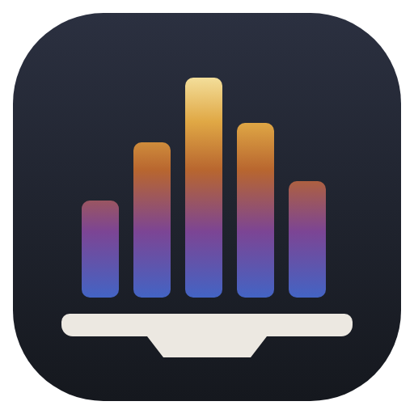
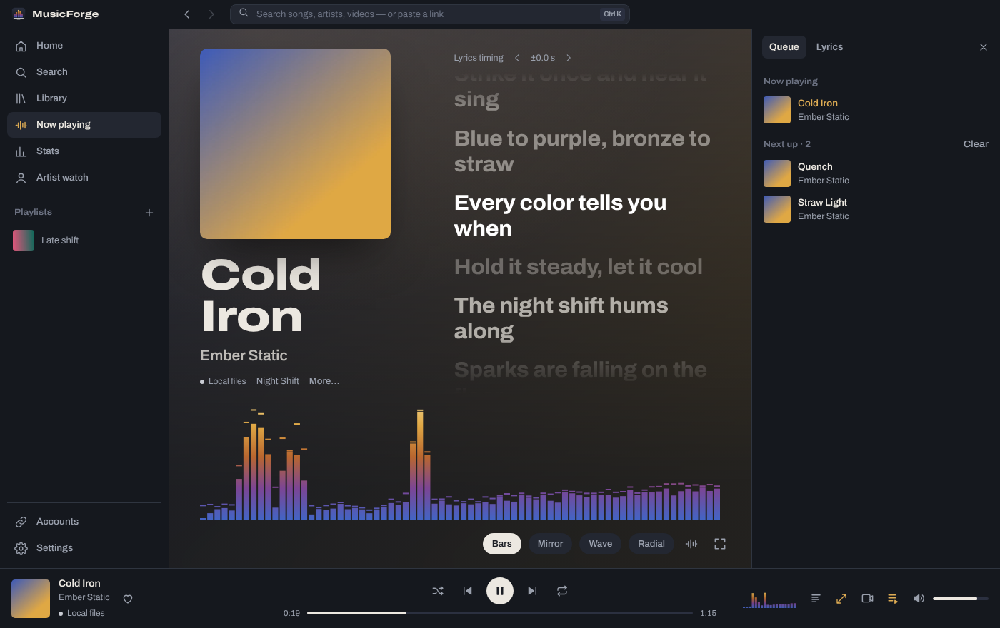
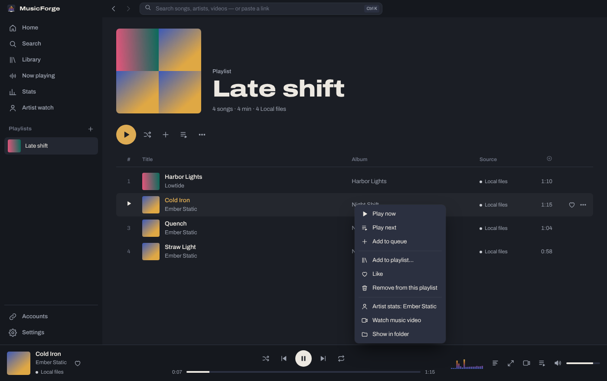
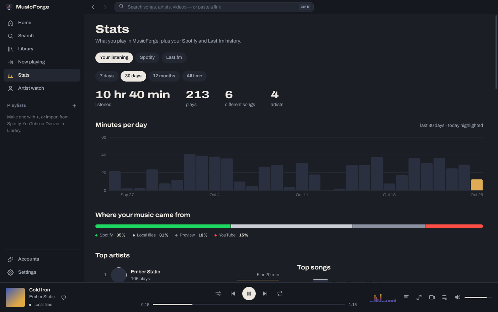

<p align="center"></p>

<h1 align="center">MusicForge</h1>

<p align="center">One desktop player for Spotify, YouTube, SoundCloud, Deezer, Apple Music, Last.fm and your own music files.<br>Live synced lyrics, audio visualizers, music videos, listening stats and artist tracking. Windows and Linux.</p>



## What it does

- **Link your accounts** and browse or import your Spotify, YouTube and Apple Music playlists, liked songs and history.
- **Mix sources in one playlist.** A MusicForge playlist can hold a Spotify song, a YouTube live version, a SoundCloud mix and a FLAC from your drive.
- **Smart source picking.** Each song plays from the best source you have, in the order you choose (local file → Spotify → YouTube → SoundCloud → 30-second preview). If a Deezer chart song isn't playable, MusicForge finds the same song on Spotify or YouTube and remembers the match.
- **Live synced lyrics** from LRCLIB, embedded tags or a `.lrc` file next to the song. The current line stays centred; unsynced lyrics scroll along with the song. Click a line to jump to it, nudge the timing with `[` and `]`, and pick a different match with **Wrong lyrics?**.
- **Audio visualizer** in four styles (bars, mirror, wave, radial) with cava-style falling peaks, in "temper" colours that run from tempered-steel blue to straw as the music gets louder. Works with Spotify and YouTube too by listening to system audio.
- **Grid search.** Top result, artists, songs, albums and playlists side by side; filter by type and source, and switch songs between grid and list (also in Library, Liked and playlists).
- **Music videos.** Switch any song to its YouTube video at the same position, or pop the video into a corner while you browse.
- **Stats.** Time listened per day, top artists and songs, which services you actually use, plus your Spotify top lists and Last.fm scrobbles.
- **Artist watch.** Follow artists and track their Deezer fans and Last.fm listeners/plays over time with daily snapshots and trend lines.
- **Scrobbling** to Last.fm from every source.
- **Little things:** sleep timer (minutes or end of song), drag songs onto a sidebar playlist, drag to reorder playlists, save the queue as a playlist, click the song length to see time remaining, scroll on the volume, optional song-change notifications, and the window remembers its size and position.
- **Desktop integration:** media keys, Windows media overlay, MPRIS on Linux (works with `playerctl`, KDE's media widget and conky now-playing scripts), tray icon, close-to-tray.

| | |
|---|---|
|  |  |

## Install

Grab the latest build from [Releases](https://github.com/LibexiL/MusicForge/releases).

| System | File | Install |
|---|---|---|
| Windows 10/11 | `MusicForge-Setup-x.y.z.exe` | Run it. Or use the `-portable.exe`, no install needed. |
| Fedora / Nobara / openSUSE | `MusicForge-x.y.z-linux-x86_64.rpm` | `sudo dnf install ./MusicForge-*.rpm` |
| Debian / Ubuntu / Mint | `MusicForge-x.y.z-linux-amd64.deb` | `sudo apt install ./MusicForge-*.deb` |
| Any Linux | `MusicForge-x.y.z-linux-x86_64.AppImage` | `chmod +x MusicForge-*.AppImage && ./MusicForge-*.AppImage` |

Windows builds are unsigned, so SmartScreen may warn the first time: choose **More info → Run anyway**.

## Linking services

Open **Accounts** in the app. Each setup has a button for every page you need to visit, a Paste button for your key, and checks the key with the service immediately (it tells you exactly what to fix if something is off). For YouTube sign-in you just pick the JSON file Google lets you download; no copying IDs by hand. Spotify and Google no longer hand out shared keys to small apps, so you make a free developer key once and paste it in. Keys and sign-ins are stored encrypted with your OS keychain (Windows DPAPI, KWallet or GNOME Keyring on Linux) and never leave your PC except to talk to that service.

| Service | What you need | What you get |
|---|---|---|
| **Spotify** | Client ID from the [developer dashboard](https://developer.spotify.com/dashboard). Redirect URI: `http://127.0.0.1:43117/callback/spotify` | Playlists, liked songs, top artists/songs, recently played, playback |
| **YouTube** | API key and/or Desktop OAuth client from [Google Cloud](https://console.cloud.google.com/apis/library/youtube.googleapis.com) (enable YouTube Data API v3) | Search, music videos, full-length matches, your playlists and likes |
| **Last.fm** | API key + shared secret from [last.fm/api](https://www.last.fm/api/account/create) | Scrobbling, your stats, artist listener counts |
| **Apple Music** | A MusicKit developer token (needs Apple Developer Program) | Import your library playlists |
| **Deezer, SoundCloud, Apple catalogue** | Nothing | Charts, search, artist fan counts, previews, SoundCloud links |
| **Local files** | Add a folder in Library | MP3, FLAC, M4A/AAC, OGG, Opus, WAV with tags, cover art and lyrics |

### How playback works (and its limits)

- **Spotify** streams are DRM-protected. By default MusicForge drives the Spotify app on your PC or phone through **Spotify Connect** (keep Spotify open somewhere; Premium required). MusicForge shows progress, lyrics and the queue; the audio comes out of Spotify. See *In-app Spotify* below for the experimental alternative. Spotify's developer rules require the app owner to have Premium and allow five users per developer app.
- **YouTube** plays through YouTube's official embedded player, shown as a video (never hidden). Some label videos don't allow embedding; MusicForge then tries the next match. The free API quota is 10,000 units a day and a search costs 100, so MusicForge searches only when needed and caches every match.
- **Apple Music** doesn't allow its streams in third-party desktop apps, so imported Apple songs play from your other sources.
- **Deezer** and **Apple catalogue** results without a full-length match play 30-second previews.

### Visualizing Spotify and YouTube

The visualizer reads MusicForge's own audio directly (local files, previews). Spotify and YouTube play in protected players it can't read, so turn on **system audio** in Settings → Visualizer or from the hint on the Now playing screen:

- **Windows:** captures system audio via loopback. Nothing to set up.
- **Linux:** pick a *Monitor of …* source for your speakers or headphones (PipeWire and PulseAudio both provide one). If none shows, enable monitor sources in `pavucontrol`.

## Keyboard shortcuts

| Key | Action | Key | Action |
|---|---|---|---|
| Space | Play / pause | Ctrl+K or / | Search |
| Ctrl+→ / Ctrl+← | Next / previous | → / ← | Seek 5 s (Shift: 15 s) |
| Ctrl+↑ / Ctrl+↓ | Volume | M | Mute |
| L | Lyrics panel | Q | Queue panel |
| N | Now playing (again to go back) | V | Full-screen visualizer |
| [ / ] | Lyrics earlier / later | ? | All shortcuts |
| S | Shuffle | R | Repeat (off / all / one) |
| Alt+← / Alt+→ | Back / forward | F11 | Full screen |

## Build from source

Needs Node.js 22+.

```bash
git clone https://github.com/LibexiL/MusicForge.git
cd MusicForge
npm install
npm start            # run it
npm run dist:linux   # AppImage + rpm + deb in dist/ (rpm needs rpmbuild)
npm run dist:win     # NSIS installer + portable exe (run on Windows)
```

### Releases and updates

Releases are automatic. GitHub Actions publishes a new release with every installer attached whenever the version in `package.json` goes up on `main`:

```bash
npm run release:patch    # 0.2.0 → 0.2.1, commits and pushes; the release follows in ~5 minutes
npm run release:minor    # 0.2.0 → 0.3.0
```

Or without a terminal: **Actions → Build & release → Run workflow**, pick patch, minor or major.

Other pushes and pull requests build test installers you can download from the run's Artifacts.

Installed copies update themselves: MusicForge checks GitHub a little after startup and every 4 hours, downloads new versions in the background, and shows **Restart to update** in the title bar. The Windows installer and AppImage install silently on restart; the .rpm and .deb install through your package manager and ask for your password once. The portable .exe can't replace itself, so it shows a download link instead. Turn this off in Settings → Updates.

### In-app Spotify (experimental)

Spotify's Web Playback SDK needs Widevine DRM, which stock Electron doesn't include. [castLabs' Electron build](https://github.com/castlabs/electron-releases) does. Swap it in and MusicForge plays Spotify inside the app automatically (Settings → Playback → Spotify playback: Auto):

```bash
npm install --save-dev "electron@https://github.com/castlabs/electron-releases#v44.9.3+wvcus"
npm start
```

On Windows, Widevine may also require signing the build with castLabs' free EVS service. This is optional; Connect mode works without it.

## Performance

- No UI framework: plain ES modules, about 300 KB of app code, lazy-loaded screens.
- Long lists are virtualised (a 20,000-song library scrolls like a 20-song one).
- Visualizer draws with typed arrays and no per-frame allocation, caps the mini visualizer at 30 fps, and stops completely when hidden or nothing is playing.
- Library rescans only re-read files whose size or date changed.
- API responses are cached in memory; cross-service song matches are cached on disk.
- Memory measured while playing: about 600 MB across all of Electron's processes (the window itself is about 200 MB).

If you see flicker or a black window (some NVIDIA + Wayland setups), turn off **Settings → Appearance → Hardware acceleration**.

## Where your data lives

| | Windows | Linux |
|---|---|---|
| Playlists, history, settings | `%APPDATA%\MusicForge\data.json` | `~/.config/MusicForge/data.json` |
| Library index | `…\library.json` | `…/library.json` |
| Keys and sign-ins (encrypted) | `…\secrets.json` | `…/secrets.json` |

Settings → Your data can export and restore a backup (keys excluded).

## Project layout

```
src/main/        Electron main process
  main.mjs       window, tray, media keys, IPC
  server.mjs     loopback server: UI, OAuth callbacks, local file streaming
  auth.mjs       Spotify / Google / Last.fm sign-in (PKCE), token refresh
  api.mjs        all service API calls (keys never reach the UI)
  library.mjs    local library scan, covers, lyrics
src/renderer/    the UI
  js/player/     playback engine + per-source adapters
  js/views/      screens
  js/services.js service connectors → one Track shape
  js/visualizer.js, js/lyrics.js
```

## Credits

Lyrics from [LRCLIB](https://lrclib.net). Charts, previews and fan counts from the Deezer API. Catalogue search from the iTunes Search API. [Archivo](https://github.com/Omnibus-Type/Archivo) typeface (SIL OFL). MusicForge isn't affiliated with Spotify, Google, Apple, Deezer, SoundCloud or Last.fm.

## License

MIT
